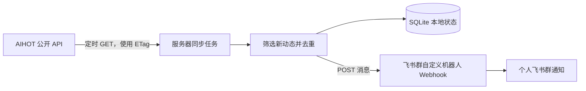

# Tibo 动态同步到个人飞书群：实现方案

> 方案日期：2026-09-24。本文只设计方案，不部署服务、不创建机器人、不发送消息。

## 1. 目标与范围

在一台常开服务器上运行轻量任务，定时读取 AIHOT 的 Tibo 重置监控公开 API。当出现新的 Codex 额度重置或重置卡**预告、确认**时，向自己的飞书群机器人发送中文通知，附原帖和 AIHOT 日历链接。

数据来源：[数字生命卡兹克](https://aihot.news/about)的 [AIHOT API](https://aihot.news/agent)。工程搭建者：鹏教科技研发部蒋宽龙。

本方案复用 AIHOT 已整理的记录，不直接抓取 X。它仅监控 AIHOT 收录的重置与发卡事件；普通 Tibo 帖子、个人账号余额和到账状态不在数据范围内。AIHOT 页面说明其上游监控约每 15 分钟检查一次，包含回复帖；个人余额仍需在 Codex 内查看。[AIHOT Tibo 重置监控](https://aihot.news/codex-reset)

## 2. 数据流

AIHOT 提供查询接口；服务器负责比较新旧数据并调用飞书 Webhook。AIHOT 的公开接入说明列出 `GET /api/v1/codex-resets`，飞书支持群自定义机器人接收 Webhook 消息。[AIHOT Agent 接入](https://aihot.news/agent) · [飞书 Webhook 机器人说明](https://www.feishu.cn/content/7271149634339422210)

## 3. 外部接口与数据选择

| 项目 | 设计 |
| --- | --- |
| AIHOT 地址 | `https://aihot.news/api/v1/codex-resets` |
| 认证 | 匿名 GET，不需要 API Key |
| 轮询周期 | 默认每 5 分钟；单实例、串行执行，可配置 |
| 条件请求 | 保存上次成功响应的 `ETag`，下次发送 `If-None-Match`；`304` 表示无需处理 |
| 飞书地址 | 用户在目标群添加自定义机器人后得到的 Webhook URL |
| 飞书消息 | 使用普通文本 `text`，含事件类型、阶段、中文内容、北京时间、原帖链接和 AIHOT 日历链接；关键词直接写在 `content.text` 中 |

已核对当前 API 响应的主要字段：顶层有 `events`、`activities`、`monitor`；`activities` 含帖子 `id`、`eventIds`、`kind`、`action`、`statusChanged`、`publishedAt`、`text`、`url`；`events` 含 `id`、`type`、`status`、`title`、`schedule`、`posts`。这是**截至方案日期的响应形态**，开发时应以接口实际响应和官方契约为准，并对缺失字段做兼容。[公开 API](https://aihot.news/api/v1/codex-resets)

## 4. 判定与去重规则

### 4.1 哪些动态发通知

1. 遍历 `activities`，只考虑 `kind = event_update` 且 `action` 为 `announce` 或 `confirm` 的记录；`kind = related` 的一般互动不推送。
2. 用 `activity.id` 作为帖子级去重键。一条帖子若关联多个 `eventIds`，只发一条合并消息。
3. 从关联的 `events` 提取事件类型：`direct_reset` 对应额度重置，`reset_credit` 对应重置卡。标题和状态优先使用事件的 `title`、`presentation.status`、`schedule.label`；不要仅靠发布时间推断已经到账。
4. 中文正文优先取同 ID 的 `event.posts[].text`（通常是重置相关节选），再回退到 `activity.text` 和 `event.posts[].fullText`。这些字段可能为 `null`；仍无中文内容时，发送简短事件说明与原帖链接，不擅自翻译或编造。
5. `announce` 显示“预告／进行中”，`confirm` 显示“确认”；发放重置卡与直接恢复额度须明确区分。AIHOT 的说明也区分预告、核验和实际到账。[状态说明](https://aihot.news/codex-reset)

### 4.2 首次启动

首次成功拉取时，把当前返回的活动 ID 记为**基线**，不发送历史通知。之后只发送新增 ID。若需要补发历史消息，应通过一次明确的管理操作指定时间范围，避免误刷群。

### 4.3 持久化与投递语义

建议使用单文件 SQLite，至少有两张表：

| 表 | 关键字段 | 用途 |
| --- | --- | --- |
| `activity_delivery` | `activity_id`（主键）、`published_at`、`state`、`attempts`、`sent_at`、`last_error` | 去重与失败重试 |
| `sync_state` | `key`、`value` | 保存是否完成初始化、上次 `ETag`、上次成功时间 |

每次先取新活动，再写入待发送状态；飞书明确返回成功后才标记为已发送。发送失败保留待发送记录，下次运行先重试待发送队列，即使 AIHOT 返回 `304` 也照常重试。网络超时可能意味着飞书已收到而客户端未收到确认，因此本方案是**尽量避免重复的至少一次投递**，不能保证严格只发一次。通知中附原帖链接，方便识别偶发重复。

## 5. 飞书消息设计

消息示例：

> **Tibo · 重置卡预告**  
> 北京时间：2026-09-23 02:23  
> 范围：Plus、Pro、Business  
> 内容：正在向相关账户加载一张重置卡。当前为预告／进行中，个人到账以 Codex 内显示为准。  
> [查看 Tibo 原帖](https://x.com/thsottiaux) · [查看 AIHOT 日历](https://aihot.news/codex-reset)

实际消息中的原帖 URL 必须使用该活动的 `url`，不能固定到 Tibo 主页。实现使用飞书 `msg_type: text`，让机器人能在正文中识别关键词；消息始终包含“Tibo”字样。[飞书消息格式和安全设置](https://www.feishu.cn/content/7271149634339422210)

## 6. 运行与安全

- **运行方式**：一个常驻服务内的定时任务，或系统定时任务每 5 分钟启动一次短程序。两种方式都要加执行锁，避免重叠运行。
- **配置项**：`AIHOT_URL`、`FEISHU_WEBHOOK_URL`、可选的 `FEISHU_SIGN_SECRET`、`POLL_MINUTES`、`SQLITE_PATH`。Webhook URL 和签名密钥放在服务器环境变量或权限受限的秘密文件中，不写进 Git、日志或通知正文。
- **飞书安全**：可开启关键词或签名校验；若启用签名校验，按飞书规定生成时间戳和签名。Webhook URL 本身也应视为密钥。[飞书安全设置](https://www.feishu.cn/content/7271149634339422210)
- **网络权限**：服务器只需向 `aihot.news` 与飞书 Webhook 地址发起 HTTPS 出站请求，不需要对公网开放入站端口。
- **日志**：记录轮询时间、HTTP 状态、AIHOT `checkedAt`、候选数、成功数、失败数及活动 ID；不记录完整 Webhook URL。
- **健康提示**：若多轮拉取失败或 `monitor.lastVerifiedAt` 明显滞后，记故障日志并通知管理员；不要把“没有新消息”误报成“监控正常”。

## 7. 错误处理

| 情况 | 处理 |
| --- | --- |
| AIHOT 返回 `304` | 更新本地检查时间，不产生新消息；继续重试待发送队列 |
| AIHOT 返回 `429` | 遵守 `Retry-After`，不并发重试 |
| AIHOT 返回 `5xx` 或网络超时 | 指数退避，保留上次状态，下个周期继续 |
| API JSON 结构异常 | 保留原始响应摘要用于排查，不推进 `ETag` 和基线 |
| 飞书返回失败或超时 | 保留待发送记录并重试；限制重试频率，避免刷群 |
| 服务器重启 | 从 SQLite 恢复去重状态和待发送队列 |

## 8. 实施顺序与验收

1. 在飞书目标群添加自定义机器人，取得 Webhook URL；用单条测试消息验证能送达。
2. 建立读取 AIHOT API 的任务，解析 `activities` 与 `events`，完成首次基线。
3. 实现筛选、中文内容回退、消息格式、SQLite 去重和飞书发送。
4. 配置定时运行、日志及失败告警；先在测试群观察，再切换到正式群。

验收条件：首次启动不补发历史；新预告仅通知一次；同事件的后续确认能再次通知；普通相关互动不通知；任务重启后不重复；API 或飞书短暂故障恢复后能补发；消息保留原帖链接，并清楚区分额度重置与重置卡。

## 9. 已知边界

- 总通知延迟受 AIHOT 上游监控周期、服务器轮询周期、缓存与网络影响。客户端每 5 分钟检查一次，AIHOT 的上游检查与缓存仍会增加延迟；不承诺实时到秒。
- AIHOT 是第三方整理页面，不代表 OpenAI 官方确认个人账号已到账；消息只反映公开记录。[AIHOT 页面说明](https://aihot.news/codex-reset)
- AIHOT API 当前没有把消息主动推送到个人飞书群的配置；需要自己的服务器轮询并发送。[AIHOT 接入说明](https://aihot.news/agent)
